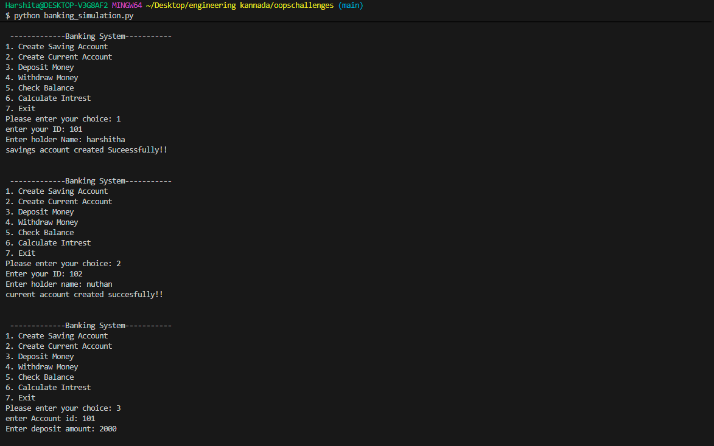
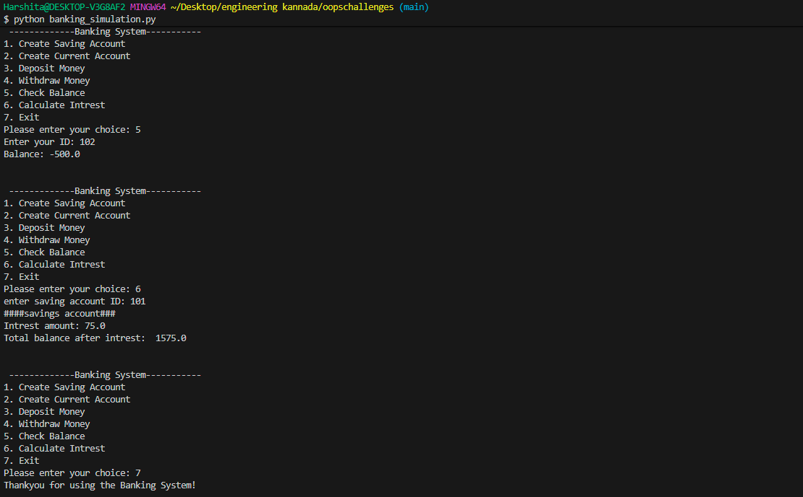

Python OOP Practice Projects

A collection of Python projects built to practise and understand Object-Oriented Programming (OOP) concepts through hands-on implementation.

Projects

1. Banking System Simulation

A menu-driven banking application that simulates basic banking operations using Python OOP.

Features

- Create Savings and Current Accounts
- Deposit and withdraw money
- Check account balance
- Calculate savings account interest
- Overdraft facility for current accounts

OOP Concepts

- Classes and Objects
- Encapsulation
- Inheritance
- Polymorphism and Method Overriding

Run the project

  python banking_simulation.py

Output

<!-- Add banking system screenshots here -->Technologies Used

- Python 3
